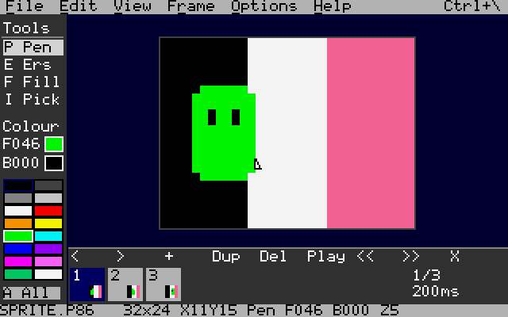

# Pix86

A lightweight, DOS-native pixel-art and frame-by-frame animation editor for game creators.

**Status:** working frame animation in VGA Mode 13h (320×200×256), targeting
8086 real-mode DOS with Open Watcom. Optional `/HIRES` uses banked VBE
640×480×256, with Mode 13h fallback.

Draw on 16×16, 32×32, 64×64, 16×24, 16×32 or 32×24 indexed documents.
Pencil, eraser, fill, eyedropper, rectangular selection and move use an original
right-hand icon toolbar. Select all with Ctrl+A, drag or nudge with arrows, then
Enter to apply or Escape to cancel; one undo restores the complete move. A collapsible
36-pixel timeline offers frame thumbnails, navigation, add/duplicate/delete and
looping playback. Per-frame timing defaults to 100 ms and adjusts from 20–2000 ms.
Four undoable actions include pixel edits, frame structure and timing. Export a current frame, numbered frames or horizontal/vertical/grid sprite sheets
as indexed BMP or RGBA PNG. New sprites default to Transparent; New also offers Opaque,
filled with the selected BG colour. Save/reopen `.P86` version 3 masks and animations;
older version 1/2 files retain their fully opaque appearance.

[Background, transparency and export verification](docs/TRANSP.md)



[Native 320×200](docs/ANIM.PNG) · [Frame menu](docs/ANMENU.PNG) ·
[High-contrast grid](docs/ANGRID.PNG) · [Original font](docs/ANFONT.PNG) ·
[Implementation and verification](docs/ANIMATION.md)

Menus repaint only changed rows; dialogs remain unchanged while idle and restore
only the covered editor region when closed. The cursor is saved/restored only
when it moves or a repaint intersects it. No full-screen shadow buffer is used.

## Build on Linux

Install [Open Watcom v2](https://github.com/open-watcom/open-watcom-v2) with its
Linux-hosted tools, DOS headers and 16-bit DOS libraries. The default location
is `$HOME/opt/watcom`; override it with `WATCOM` if needed.

```sh
export WATCOM="$HOME/opt/watcom"
./scripts/build.sh
file mnt/PIX86.EXE
```

The script checks `wcl`, `wcc` and `wlink`, builds with `-bt=dos -ms -0` (16-bit
DOS, small model, 8086 instructions), and places `PIX86.EXE` in `mnt/`. Compiler
warnings are errors. No DOS extender, DPMI, SDL or graphics library is required
by the application. Build intermediates and `PIX86.MAP` stay in `build/`.
`mnt/` and `build/` are ignored by Git. DOS-facing source and executable names
fit 8.3; host scripts and documentation run on Linux.

## Run in DOSBox-X

From the repository root:

```sh
dosbox-x -defaultconf -c "mount c ./mnt" -c "c:" -c "PIX86.EXE"
```

Alternatively, mount `mnt/` in an existing DOSBox-X session, switch to `C:`,
and run `PIX86`. Use VGA emulation and launch from a DOS text mode. DOSBox-X may
require a click or Ctrl+F10 to capture the mouse; Ctrl+F10 releases it. On real
DOS, load a compatible INT 33h mouse driver first. Without a driver, the workspace
opens with an explanatory message and keyboard shortcuts/ESC still work.

Choose canvas size when launching (default: 32×32):

```text
PIX86 16
PIX86 32
PIX86 64
PIX86 16x24
PIX86 32 /NOMOUSE
```

Choose another size with New or by opening a project. `/NOMOUSE` skips driver
initialization for diagnosis.
Exit restores the prior text mode/page/cursor, clearing the prior screen. Copy
only `PIX86.EXE` to DOS; no runtime DLL or data assets are needed.

## Drawing controls

| Control | Action |
| --- | --- |
| Left toolbar or P / E / F / I | Pencil / eraser / fill / eyedropper |
| Left-drag on canvas | Draw or erase; one drag is one undo action |
| Left-click with fill | Fill four-connected matching pixels; one action |
| Left-click with eyedropper, or right-click canvas | Pick foreground index |
| Left-click palette | Select foreground (FG) |
| Right-click palette | Configure eraser/clear background (BG) |
| + / = and - | Increase/decrease integer zoom within workspace limits |
| S / M | Rectangular selection / float the current selection |
| Ctrl+A / Ctrl+D | Select all / deselect (cancel a pending move) |
| Arrows (selection active) | Move one artwork pixel; begin floating if needed |
| Enter / Escape (floating) | Apply one atomic edit / cancel without changing artwork |
| Delete (selection active) | Clear selected pixels in one undo action |
| G | Toggle neutral pixel grid (initially off, visible at zoom ≥3) |
| 8 / 6 | Toggle 8×8 / 16×16 guides (visible at zoom ≥2) |
| Tab | Show/hide timeline and refit integer zoom |
| Insert / D / Delete (no selection) | Add blank / duplicate / delete active frame |
| , / . | Previous / next frame (wraps) |
| Space | Play/stop looping animation |
| ( / ) | Faster / slower active frame by 10 ms |
| A / B | All 256 colours, foreground / background |
| [ / ] | Previous / next working foreground colour |
| U / Ctrl+Z | Undo |
| R / Ctrl+Y | Redo |
| C | Clear using document blank policy, undoable |
| Ctrl+\ (primary), F10 / Alt+F,E,V,R,O,H | Menu bar / File, Edit, View, Frame, Options, Help |
| Arrows / Enter / Esc (menu open) | Navigate / execute / close menu |
| F2 | Save (asks for a name on an untitled canvas) |
| Shift+F2 | Save As |
| File → Export | Native-size BMP/PNG: current frame, numbered frames or sprite sheet |
| F3 | Open a .P86 project |
| N | New document; choose one of six square/rectangular sizes |
| ESC | Cancel/deselect first; otherwise Exit with unsaved-changes confirmation |

Sixteen large working swatches stay visible in the sidebar. A/B opens the
full 256-colour picker for foreground/background; arrows and Enter choose an
index, Tab switches the target, and Escape cancels. Left/right click selects
FG/BG in either palette. [ and ] cycle working foreground colours. New indices
are remembered in eight recent slots, alongside eight stable defaults. These
selections never remap existing pixels or edit the artwork DAC palette.

The sidebar leaves a 274×176 drawing region, or 274×140 with the timeline open. Text uses an original crisp 6x8 bitmap font; UI colours use existing
palette entries so saved artwork retains its colours. The single compact status
line shows filename, modified state, dimensions, coordinates, tool, FG/BG and
zoom; `X--Y--` means the pointer is outside the canvas. Grid lines belong to the view, never
the artwork. Tool rows are 10 pixels high, and menu rows are 9 pixels high.
Grid starts off;
G shows a contrast-based dashed pixel mesh at zoom ≥3; 8/6 toggle solid tile guides. Help → Font sample
displays all supported characters.

The canvas is centred, initially at the largest fitting zoom: 11× for 16×16,
5× for 32×32 and 2× for 64×64. Zoom 1× is available for every size. Drawing pauses
outside the canvas; returning while holding the button starts a new segment in
the same action, without drawing a bridge across the interface. Tool, zoom,
grid, clear or history shortcuts finish a held stroke; release before starting
a new one. Four actions are retained; older actions expire. Only actual artwork/animation
edits clear redo, so colour selection, zoom and no-op tools preserve it.

## Files and unsaved changes

Press F2, type `PLAYER` and press Enter to save `PLAYER.P86`. The filename field
starts selected: typing or Backspace replaces the prefill. Left/Right/Home/End
move the cursor; Backspace/Delete edit around it. Enter accepts, Esc cancels.
Tab/Shift+Tab move between the field and OK/Cancel; click controls or the field
to operate them with the mouse. Long paths scroll within the field. Save As
always opens this dialog. There is no graphical file browser.

Use DOS 8.3 filenames and directory components, for example `C:\ART\PLAYER.P86`
or `..\ART\PLAYER`. The default extension is `.P86`. Paths are limited to 79
characters, and the directory prefix must also leave room for an 8.3 temporary
name. Spaces, wildcards, device names (CON, NUL, COM1, etc.) and long filenames
are rejected. Existing directories must already exist; drive-relative and rooted
DOS paths are supported. File I/O uses uppercase canonical names.

Saving asks before overwriting any existing file, including the current project.
The old file stays intact until the new temporary file has been written, flushed
and closed. Replacement keeps a backup until installation succeeds. Errors leave
the canvas unsaved; a rollback failure displays retained BAK/TMP paths for manual
recovery. See [replacement guarantees and format](docs/FILE_FORMAT.md).

An asterisk at the start of the status line means the project differs from the
saved state.
This compares all frame pixels, counts, timings, dimensions and saved FG/BG selections, independently
of undo-history position. Choosing another FG/BG therefore also marks a project
modified. Undo can return to the saved artwork, including after history expiry;
view changes alone do not affect it. Successful loading resets undo/redo and
restores the file's size and FG/BG. Invalid or unreadable files leave live artwork
and the current filename unchanged.

New, Open and Exit ask before discarding unsaved changes. Y or Yes permits
discarding; N, Esc or Cancel abandons the operation. Cancel is initially selected;
Tab/arrows and Enter operate the buttons. A cancelled or failed Open retains the
current artwork. New starts an unnamed blank canvas. Saving/loading messages
are acknowledged with any key. Menus display file/drawing shortcuts. Ctrl+\ opens File and closes an open
menu when pressed again. F10 and Alt+F/E/V/R/O/H are alternatives;
Left/Right switches headings, Up/Down selects items, Enter executes and Esc
closes. Frame (Alt+R) operates frames, playback and timing; onion skin remains disabled. Click a heading/item
to use menus with the mouse; outside clicks close and are consumed. Release
held buttons after closing a menu/dialog before drawing. See
[interface design and reference review](docs/UI_DESIGN.md).

## Tests and development notes

```sh
./scripts/test.sh                     # strict C89 host suites; requires cc
python3 tests/mzcheck.py mnt/PIX86.EXE  # executable container check
./scripts/dostest.sh                  # build EDTEST, IOTEST, UITEST, KBDTEST and ANIMTEST for DOS
./scripts/doscheck.sh                 # build interactive restoration harness
```

Run `EDTEST > EDTEST.TXT` in DOSBox-X to exercise tools, coordinates, history and
gestures with Watcom's 16-bit integers. The larger mock-framebuffer suites are
host-only. Run `IOTEST > RESULT.TXT` in a separate scratch directory to test native
file roundtrips, malformed files, dirty tracking, dialogs and injected write,
flush, close, rename and rollback failures. It creates/removes test fixtures;
run it only in a disposable directory. The host test script uses `build/iotest/`. UITEST exercises menu navigation,
mouse hit testing, real dialog loops with scripted input, cursor editing and
drawing handoff; it uses mock video/input and performs no hardware checks. For interactive cleanup checks, run
`DOSCHECK`, then ESC. KBDTEST injects BIOS words to check the real keyboard
module; `KBDTEST /LOG` records raw physical keystrokes to KEYS.TXT until Escape. Also run
`DOSCHECK null 16` and `DOSCHECK iret 64` to exercise missing mouse vectors and
other canvas sizes. Reports go to `MOUSE.TXT`, `NULL.TXT` and `IRET.TXT` in `mnt/`.
The harness deliberately changes the driver vector temporarily; use an emulator.
These executables are development tools and are not needed to run Pix86.

See [actual test results and checklist](docs/TESTING.md) and
[architecture, memory budget and provenance](docs/ARCHITECTURE.md). Native
FreeDOS/MS-DOS and real VGA/mouse hardware checks remain outstanding.

## Goals

- Run on FreeDOS, MS-DOS and DOSBox.
- Implement the editor independently in C, targeting 16-bit DOS initially with Open Watcom.
- Make animation a first-class feature: frames, timeline, playback, duplication, and onion skinning.
- Provide an approachable mouse-driven pixel editor with VGA 256-colour palette tools.
- Export sprites and animation frames in useful formats for DOS game development.
- Keep drawing and animation logic separate from platform-specific video, input, and UI code.

Onion skinning, additional export formats and native hardware verification remain future work; the implemented subset is described above.

## DOS engineering reference: Zine

[Zine](https://github.com/raygibbon/zine) is our existing 16-bit DOS C project. Use it as a practical reference for the Open Watcom build workflow, DOSBox-X testing, real-mode memory constraints, DOS-safe filenames, small C modules, and keeping platform-specific pieces isolated.

Zine is a static-site generator, **not** a graphics editor. Its Watt-32 networking and bundled third-party dependencies are not required for Pix86 and must not be imported merely because Zine uses them. Review licences and implementation suitability before any intentional reuse; by default write Pix86-specific code.

## DOS interface reference: TDE

[TDE (Thomson-Davis Editor)](http://adoxa.altervista.org/tde/dl.php?f=source) is a reference for the look and operation of compact DOS interfaces: menu bars, keyboard-first navigation, dialogs, status bars, and consistency between mouse and keyboard controls. Its software is described as public domain, but Pix86 should not incorporate TDE source or assets without a separate explicit review. Develop original VGA UI code suited to a graphics editor, rather than porting TDE's text-mode UI.

## References, not dependencies

[GrafX2](https://grafx2.chez.com/) and [Autodesk Animator / Animator Pro](https://github.com/AnimatorPro) may be studied **only as references** for user workflows, expected features, and broad design ideas.

**Pix86 must be independently implemented.** Do not copy, translate, adapt, import, or reuse any source code, assembly, algorithms expressed in source, artwork, icons, fonts, palettes, UI graphics, documentation text, or other assets from either project. Do not vendor their repositories or link against their code. Do not reproduce distinctive UI artwork or branding.

Instead, write original specifications describing observable behaviour and design our own implementation. For file-format interoperability, rely on independently published format specifications and write original parsers/encoders. Record any external references in documentation, including what was learned, without reproducing protected material.

LibreSprite and TDE are also workflow/UI references only; no source or assets
were imported for M2.5. The limited local TDE behaviour review and original
Pix86 design are recorded in [UI_DESIGN.md](docs/UI_DESIGN.md).

See [AGENTS.md](AGENTS.md) for contributor and AI coding-agent rules.

## Initial development direction

- Language: portable C.
- Compiler: Open Watcom for DOS targets.
- First target: 16-bit VGA DOS.
- Licence: [MIT](LICENSE) for original Pix86 code. New dependencies require a separate licence and redistribution review.

## Animation limits

At most 16 frames and 16,384 total pixel bytes: four frames at 64×64, up to
16 frames at every smaller supported size. Seven preallocated far-heap document
blocks reserve 129,318 bytes; failed initialization frees partial allocations.
DGROUP remains below 64 KiB. See [architecture](docs/ARCHITECTURE.md) for the
measured budget and ownership rules. All indices, including zero, remain paintable opaque colours; transparency uses a separate mask.
Onion skin, layers and GIF export are deferred. BMP and PNG sprite sheets are implemented.
Playback uses elapsed DOS clock time (BIOS-resolution timing), and stops when
menus/dialogs open or an editing command is used. Painting is blocked during play.

Run `scripts/test.sh`, `scripts/build.sh`, `scripts/dostest.sh`, then
`scripts/rundost.sh` to execute eight editor/I/O suites and two video-driver runs. The last command requires
DOSBox-X and a display; override its executable with `DOSBOX_X`. IOTEST, BMPTEST, ALPHTEST, SELTEST and
ANIMTEST run in an exclusively created disposable directory.

## BMP and PNG export

File → Export accepts a DOS 8.3 destination (default `.BMP`), current/all/sheet
mode, horizontal/vertical/grid layout and 1–16 grid columns. Choose PNG Preserve for alpha or Flatten with a BG
index; BMP uses Flatten. Tab changes focus;
arrows change options, Enter exports and Escape cancels. Mouse clicks cycle
options. All Frames uses up to four stem characters plus `0001`, `0002`, etc.
Existing outputs require confirmation before any batch file is written. Failures
report completed/total and recovery paths. Export preserves native project/dirty
state, all 256 indices and opaque index zero. Unused BMP sheet cells use BG; PNG Preserve uses transparent unused cells.

See [format, screenshots, streaming limits and test evidence](docs/EXPORT.md).
`BMPTEST` checks output in DOS; optional `BMPVIEW` displays small exported BMPs.

## Selection and display modes

[Workflow, screenshots, memory and verification](docs/SELECTION.md).
The working palette remains left; six original tool icons now sit right. Classic
320×200 has 8×8 marks in compact buttons; `/HIRES` uses independently drawn 16×16
marks and taller palette swatches. Both retain native 6×8 text, integer canvas
zoom and the same artwork indices. Enhanced mode requires banked VBE 1.2 mode
101h; unavailable hardware falls back to classic. No full-screen RAM buffer,
extender or image-format change is added.

A floating move leaves project pixels and dirty state unchanged until Enter.
Other tools, frame commands and file operations require Apply/Cancel first.
Transparent holes composite using mask bits; real index-zero black moves normally.
Source pixels clear to transparency or BG according to document blank policy.
Moves beyond artwork edges clip; committed off-canvas pixels can be recovered by
Undo. Selection itself is transient and never saved or exported.
