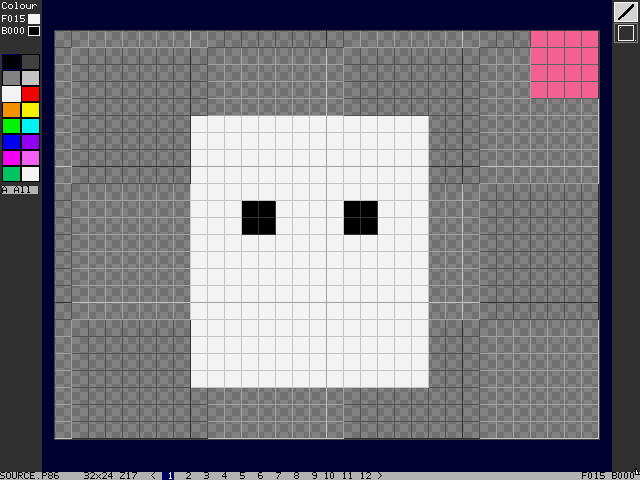
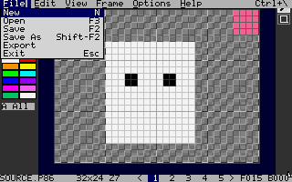
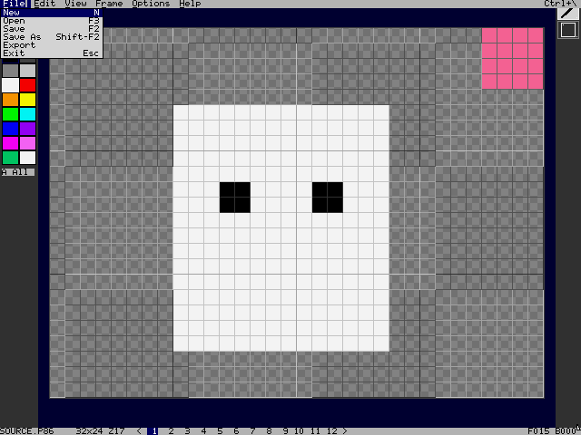
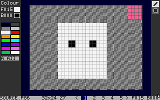
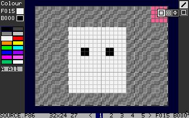
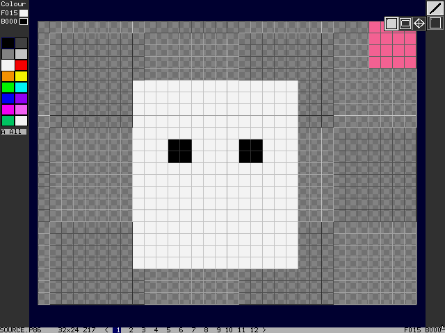
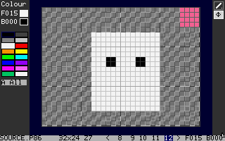
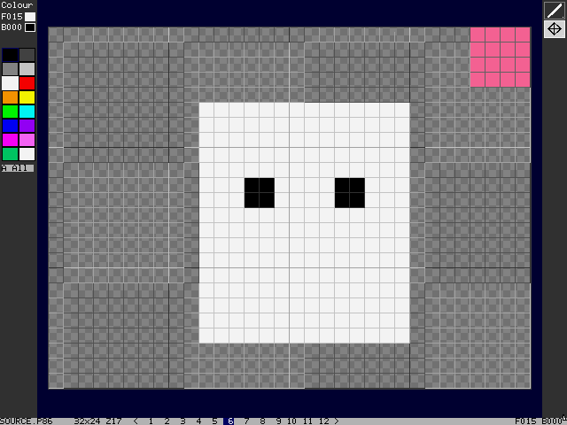
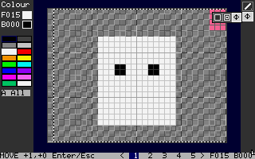
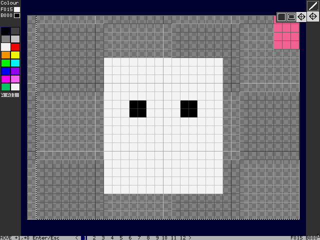

# Compact workspace and temporary controls

Normal editing keeps only the palette at left, two tool groups at right and one
bottom status row. There is no permanently visible top menu or thumbnail panel.
The graphics drivers, fixed artwork palette, v3 masks, history and export formats
are unchanged. This branch starts at main `be021d3`, including the merged selection
and first-party VGA/VBE integration; older unmerged branches are retained.

## Controls

- Ctrl+\ temporarily shows the full top bar and File dropdown. F10 recalls the
  last heading; Alt+F/E/V/R/O/H opens a heading. Existing arrows, letters and Enter
  navigate/execute. Escape or Ctrl+\ closes everything and restores the editor.
  After opening, mouse clicks can choose headings/items. Hidden headings have no
  invisible click targets: the reclaimed row is ordinary artwork workspace.
- Left-click a right-hand group to activate its last choice. Right-click opens
  a horizontal flyout to its left, over drawing space. Drawing offers Pencil,
  Eraser, Fill and Eyedropper. Selection offers Rectangle, Select All and Move.
  Only implemented tools are exposed. P/E/F/I/S/M and Ctrl+A still work directly
  and update the remembered group icon.
- Choose a flyout icon with the mouse, or Left/Right then Enter. Hover/selection
  indicators use the existing theme. Escape or an outside click dismisses without
  changing tools or drawing. The dismissal press and held release are consumed.
- Bottom arrows change the active frame, wrapping at either end. Frame numbers
  select directly and highlight the current frame. Classic shows up to five;
  Enhanced shows up to sixteen. Moving beyond the displayed page reveals nearby
  numbers. Only actual frames are drawn; there are no empty slot boxes.
- Tab independently toggles the optional 36-pixel thumbnail timeline, initially
  hidden. Existing frame add/duplicate/delete, playback and timing shortcuts remain.

The status prefix shows filename/dirty marker, dimensions and zoom. Selection or
move information replaces that prefix while active; frame targets and FG/BG stay
in reserved columns and never overlap it. There is no second permanent status or
playback row. Menu/flyout opening never moves, resizes or refits the canvas.

## Selection and ownership

Modal dialogs own input first, then menus, flyouts and editor input. Opening a
menu closes a flyout; opening a group can replace an open menu. While an overlay
is active, editing keys and pointer events do not reach the canvas. Release any
held dismissal button before starting a stroke.

Opening a temporary control finishes an ordinary stroke and pauses an in-progress
rectangle/selection drag at its current bounds/offset. A floating proposal remains
pending: no commit, cancellation or recapture occurs. In particular, choosing Move
from the flyout while already floating preserves captured indices, mask and offset.
Escape dismisses the overlay first; a subsequent Escape can cancel the move.
Existing Enter, Ctrl+D, arrows and atomic undo/redo remain unchanged.

## Native screenshots

These are native 320×200/640×480 DOSBox-X captures of an original 32×24,
twelve-frame fixture. The pink corner deliberately lies beneath the selection
flyout. Restoration images compare byte-for-byte with the corresponding originals.

| State | Classic | Enhanced |
|---|---|---|
| Normal, menu hidden |  |  |
| Temporary menu |  |  |
| Menu dismissed |  |  |
| Selection flyout |  |  |
| Flyout dismissed |  |  |
| Compact frame navigation |  |  |
| Floating selection with flyout |  |  |

## Architecture and budget

All geometry follows the active display and original font metrics. The central
normal drawing reservation is 256×189 in Classic and 566×469 in Enhanced. Its top
edge starts at y=1; the menu overlays y=0..8. Classic group buttons are 14×12 with
8×8 artwork; Enhanced uses 24×20 buttons and independently drawn 16×16 artwork.
Flyouts have one horizontal row: Drawing is 50×14/82×22, Selection 38×14/62×22.
Their right edges meet the parent button's left edge; no layout state changes.

`flyout.c` supplies portable group/command mapping, hit geometry and compact frame
pages. `UiState` holds only group/hover integers; Editor adds two view-only last-tool
bytes. `screen.c` restores covered regions via the existing clipped renderer.
Opening/closing menus writes only the bar/dropdown footprints, with no status-row
change. Flyout drawing/hover/restoration stays in its own footprint; changing a
remembered tool updates its group button. Frame/count changes update frame cells;
ordinary idle polling writes nothing. The outer restoration footprint handles
cursor protection without hiding an unrelated cursor. There are no screen saves,
new image snapshots, overlay allocations or changes to persistent document data.

Measured final DOS build: EXE 68,804 bytes; near code 62,600 bytes; DGROUP 43,280
bytes including the 4096-byte stack, leaving 22,256 bytes below 64 KiB. The existing
seven far document blocks still reserve 129,318 bytes. No graphics engine, widget
framework, third-party library, scaled font or unimplemented shape tool is added.

## Verification

- All twelve strict C89 host suites pass, including new full-framebuffer tests.
- All twelve suites pass with AddressSanitizer/UndefinedBehaviorSanitizer.
- `scripts/build.sh` and `scripts/dostest.sh` build with Open Watcom warnings as
  errors. `scripts/rundost.sh` passes EDTEST, IOTEST, UITEST, KBDTEST, ANIMTEST,
  BMPTEST, ALPHTEST, SELTEST and VGA/VBE VIDTEST runs.
- Portable UITEST exercises group choices, remembering, keyboard/mouse ownership,
  menu/flyout replacement, consumed releases, frame hit targets and sixteen-frame
  paging in both layouts with real DOS 16-bit arithmetic.
- The host framebuffer suite compares every pixel after menu and flyout dismissal
  in both resolutions. It covers all headings, F10/Alt/Ctrl+\, reclaimed top-row
  drawing and undo, hover, outside-click holds, grid/checker/guides, selection,
  floating Move, optional timeline, status highlights and all sixteen frames.
  It checks actual write bounds, idle writes, cursor reads, unchanged view/zoom,
  dirty state and source indices/masks. Existing modal/file/export regressions pass.
- Native GUI checks open/dismiss menus and flyouts, choose Rectangle/Select All/Move,
  preserve a floating proposal through flyouts, navigate twelve frames with mouse
  and keyboard, and toggle the optional timeline. Complete native framebuffer
  comparisons match before/after restoration. Saving afterwards reproduces every
  byte of the original twelve-frame `.P86`, including mask bits and hidden indices.

Physical DOS/SVGA cards and external mouse drivers remain unverified. Native tests
use DOSBox-X `svga_s3`, 40,000 cycles and full-precision INT 33h reporting. Persistent
formats, palette semantics and the existing bounded history limits are unchanged.

## Reference review and provenance

The requested local TDE 5.1v review covered `pull.c` (`main_pull_down` entry/return
behaviour), `menu.c`, screen-line declarations in `tdestr.h`, and the DOS line
save/restore routines in `dos/console.c`. Only the functional contract was used:
temporarily show controls, retain menu choices and restore the previous display.
Pix86's implementation uses its existing pixel-region redraw, not a TDE buffer,
assembly routine, structure or translated implementation. No TDE source/assets
were imported. [TDE reference site](http://adoxa.altervista.org/tde/dl.php?f=source).

[Aseprite's toolbar documentation](https://www.aseprite.org/docs/tool-bar/) was
reviewed for workflow context. The requested right-click, leftward single-row
flyout is implemented with Pix86's own two groups, original bitmap marks, fixed
DOS theme and state transitions. No reference icons, fonts, code, layouts or
bundled assets were copied. Existing repository MIT licensing applies; no new
attribution or redistribution obligations are introduced.
