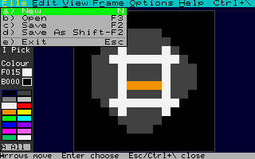
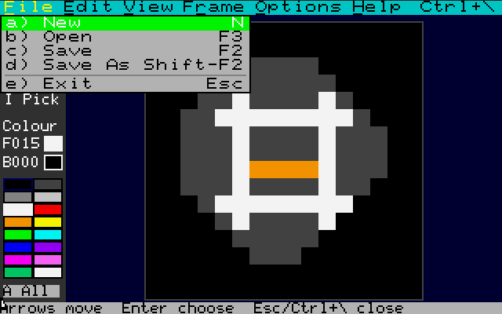
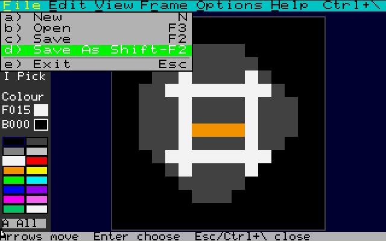
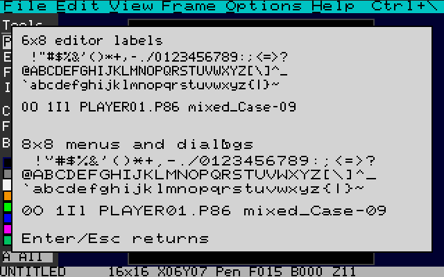
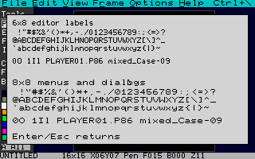
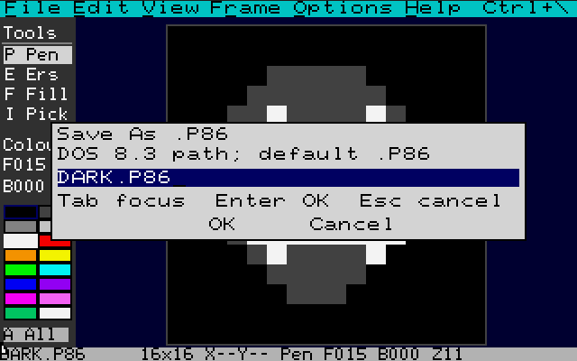

# Font and menu behaviour review

Branch feature/tde-font-menu starts at main 6229285 after PR #6.

Reviewed local TDE tde51vs/pull.c, menu.c, menucua.c, default.c,
dos/console.c, config/tde.cfg and config/menu.cfg. Reference repository:
https://github.com/raygibbon/tde. The TDE File menu and dialog visible in the
previously supplied screencast provide visual context; separate copies of the
two review screenshots are not present in the available attachments.

Observable menu conventions: a cyan heading row with dark text, grey framed
popups, a yellow active heading, high-contrast selected commands, muted unavailable commands, alphabetic
prefixes, aligned shortcut columns and separator rules. Up/Down wraps through
command rows without landing on separators; Left/Right changes headings.
Letter selection executes an available command immediately. Enter cannot run
an unavailable command. The current row is remembered per menu; dismissal
restores the covered document. Ctrl+Backslash is the default PullDown binding.
TDE offers additional text-editor menu/submenu operations that Pix86 does not
need. Standard and CUA configurations group commands differently; Pix86 keeps
its own six headings and functional graphics-editor commands.

These are behavioural observations, not implementation templates. Pix86 uses
its original graphical renderer, its own command descriptions and bounded row
memory, and restores from its editor model. No TDE code, structures, font,
assets, strings or pixel layouts are imported, translated or adapted.

## Original font comparison

Compared the existing 6x8 face and an independently hand-drawn 8x8 prototype
at native resolution using the real bitmap renderer. The 8x8 face was rejected:
it fits only 40 columns, against the reference's approximately 80. A narrower
5x8 trial still left the lettering and rows too large. The final menu/dialog
face is an original **4x6** design: three ink columns plus a blank spacing
column, five body rows and a sixth row for descenders. It fits 80 columns and
reduces the row height as well as its width. It is newly hand-drawn, not scaled,
cropped or generated from the wider prototypes or a reference font.

The existing 6x8 face stays on editor labels/status, preserving the 274x176
workspace, tools and palette geometry. All 95 printable ASCII glyphs are
supported in both faces, with distinct lowercase and distinguishable filename
characters. No scaling, antialiasing, ROM data or external font input is used.
The very small face trades stroke detail for the requested screen density;
review it at native resolution or integer scaling. Renderer roles have explicit
width and height metrics, opaque backgrounds and local clipping, without a
mutable global font.

`PIX86 /FONT` opens the native comparison without adding a non-setting entry
to Options or changing the requested two-entry Help menu.

Menu rows stay seven pixels high, with three-pixel separators and tight padding.
Widths come from prefix, longest label and shortcut metrics. The whole six-menu
heading row and Ctrl+Backslash reminder fit 320 pixels. Dialogs grow only as
needed for the chosen font, with bounded columns and scrolling filename text.
No canvas or file-format changes are required.

## Final visual and interaction checks

Compared Pix86's open File menu directly with the TDE File frame at 20 seconds
in Screencast_20261114_222249.mp4. Cyan headings, yellow active heading, grey
paper, green/white selection, muted disabled commands, prefix/shortcut columns
and separator rules now share the same DOS conventions. TDE's longer text-mode
menu and font are not reproduced pixel-for-pixel; the 4x6 face is independently
hand-drawn for VGA graphics. The editor retains 6x8 labels to preserve space.

File measures 84x40 including its border, Edit 68x26, View 60x26, Frame
56x23, Options 68x23 and Help 52x16. Rows are content-sized independently;
separator height is three pixels and is included in painting and hit testing.
No row/column depends on a fixed common popup width.

The editor face contains 760 bytes and the menu/dialog face 570: 1330 combined. Selection memory is six
bytes per Menu; the screen cache grows from 96 to 102 bytes. The 8086/small-model
build has a 45,538-byte EXE, 40,549 bytes of near code and 50,800-byte DGROUP
including its 4096-byte stack, leaving 14,736 bytes below 64 KiB. Linked memory
is 91,376 bytes. There is no new heap allocation or screen backing store.

Seven strict C89 host suites pass; the real-main paint/application suite also
passes ASan/UBSan. Font tests cover all printable glyphs, every lowercase,
ambiguous filename characters, opaque backgrounds, screen/control clipping
and extreme coordinates for both faces. Menu tests cover every prefix in both
cases, disabled commands, rule skipping/hits, per-heading memory and reopening.
The VGA mock retains exact restoration, zero-idle-write, two-row update and
one-startup-clear assertions.

Actual DOSBox-X testing at fixed 3000 cycles passed Ctrl+Backslash, letters,
arrows, disabled Frame commands, remembered rows across headings/dismissal,
mouse heading/command/outside clicks, filename and confirmation prompts,
continuous editor/file workflows and deliberate exit. File, font, filename and
confirmation idle captures remain identical after two seconds. A 360-frame
navigation recording has one hash for the uncovered canvas. These captures
inspect emulated VGA output; exact write counters are host-instrumented.
Reference frames and test logs/recordings remain local under build/fontmenu/.
Real hardware/native DOS remain untested; DOSBox-X/native-suite results and
restoration evidence are recorded in TESTING.md.
