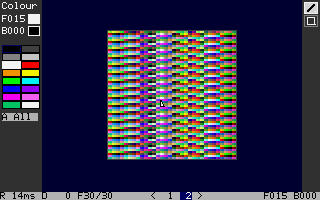
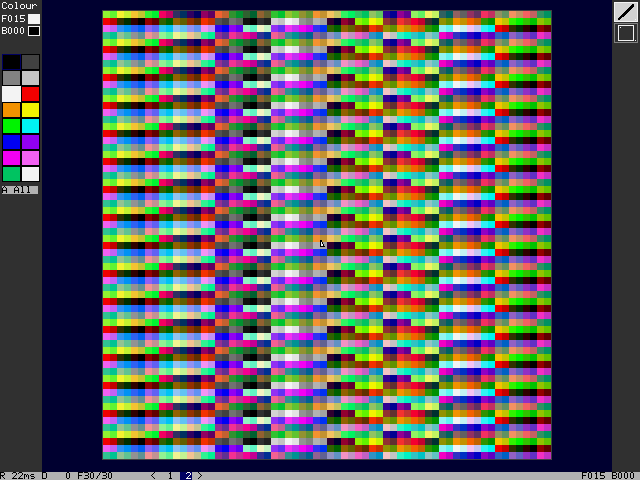

# Editor rendering performance

This audit covers the existing C89, 8086 real-mode rendering pipeline. It adds
optional profiling and focused incremental updates; it does not replace the
screen architecture or allocate a screen-sized buffer.

## Pipeline and findings

`main.c` polls input, advances the editor and passes `EDIT_*` invalidations to
`screen.c`. The screen dispatcher selects the affected painter. `render.c`
composes canvas cells, selection overlays, controls and timeline thumbnails;
`video.c` clips operations and dispatches to Mode 13h or the banked VBE driver.
The software cursor saves/restores its small footprint and is hidden only when
a protected repaint intersects it.

The highest-cost avoidable work found in the initial audit was:

1. Diagonal pencil/eraser segments repainted their entire bounding rectangle,
   including unchanged canvas cells.
2. Flood fill invalidated the complete canvas even though the fill queue already
   identified the changed cells.
3. Ordinary frame navigation took the broad canvas/status/timeline update path,
   repainting unchanged canvas areas and timeline thumbnails.

Stroke and fill paths now pass their changed cell indices to the shared cell
painter. Frame navigation compares visible frame pixels and transparency, uses
the existing incremental canvas renderer, and updates frame indicators without
repainting unchanged thumbnails. Strokes/fills refresh only the active thumbnail.
Structural timeline changes still repaint the timeline. Selection movement
uses its clipped damage region; modal and menu restoration repaints only covered
regions. Tool groups, status text, and timeline indicators use existing
selective painters rather than a new invalidation framework.

VGA rectangle fills use contiguous scanline writes. VBE rectangle fills now use
contiguous far-memory writes bounded by the current bank window. VBE clipping
and bank-boundary handling remain in the video driver. No application-wide
framebuffer, graphics library, or DOS extender is introduced.

## Host write-count evidence

The host framebuffer mock compares optimized work against full-render reference
images, so these counts check both the amount of work and pixel correctness.
The before values below were captured with the same deterministic operations
before the corresponding change; the current tests reproduce the after values.
Counts are framebuffer writes, not elapsed-time measurements.

| Operation | Before | After | Change |
|---|---:|---:|---:|
| Diagonal stroke segment | 14,641 | 1,210 | -91.7% |
| Full-canvas flood fill | 49,732 | 30,976 | -37.7% |
| Dense frame navigation | 50,932 | 32,176 | -36.8% |

Other current counts include 2,080 writes for a 16-cell fill, 1,321 for sparse
frame navigation, and 145 for a stroke with the timeline visible. A single
pixel operation remains 121 writes. Full-frame reference comparisons in the
host suite detect missing pixels and restoration artifacts.

## Earlier coarse-clock DOSBox measurements

`tests/perfdos.c` performs 32 full redraws, 32 75%-changed frame diffs, 32
playback renders (one initial full render followed by 31 diffs), and a diagonal
stroke for 16×16, 32×32, and 64×64 documents. `scripts/profilebuild.sh` builds
the instrumented 16-bit small-model harness with Open Watcom. The runs below
used DOSBox 0.74-3, normal 386 emulation at 40,000 cycles, for both VGA 320×200
and VBE 640×480. DOSBox-X was unavailable in this environment.

The reported render totals are DOS `clock()` ticks over eight operations.
Open Watcom reports 1,000 ticks/second, but DOSBox/DOS clock advancement is
effectively about 55 ms per tick. The totals are coarse and noisy; they should
not be read as sub-millisecond timing or a precise frame-rate benchmark.

| Mode / size | Full redraw ×32 | 75%-changed diff ×32 | Playback ×32 |
|---|---:|---:|---:|
| VGA 16×16 | 165 ticks | 220 ticks | 219 ticks |
| VGA 32×32 | 495 ticks | 439 ticks | 439 ticks |
| VGA 64×64 | 1,538 ticks | 1,428 ticks | 1,483 ticks |
| VBE 16×16 | 1,703 ticks | 1,208 ticks | 1,208 ticks |
| VBE 32×32 | 3,131 ticks | 2,252 ticks | 2,361 ticks |
| VBE 64×64 | 5,987 ticks | 4,559 ticks | 4,614 ticks |

The baseline incremental renderer substantially reduced framebuffer writes in
both modes, but dense transitions still paid for per-cell painter and cursor
calls. This is the before measurement for the adaptive playback change below.
The clock is too coarse and noisy for sub-millisecond claims; use the numbers
directionally.

## Adaptive rendering (2026-11-15)

The remaining bottleneck was repeated rectangle setup and banked far-memory
fills for every enlarged artwork cell. `canvas_cell()` also recomputed selection,
preview and grid state on plain opaque artwork. Large pink areas were progressively
visible because Mode 13h/VBE display memory is live during these writes. The
recording named in the request was not supplied with the repository; the harness
reproduces dense and flat-colour transitions independently.

The renderer now makes a small decision **per artwork row**, without a second
whole-canvas pass or a screen framebuffer:

* **Cells:** compare indices and explicit mask bits, retaining the existing
  compositing painter for sparse changes or grid/guide/selection overlays.
* **Spans:** combine adjacent changed cells with equal opacity and colour.
  Transparent runs use the existing screen-aligned checkerboard, split only at
  its eight-pixel boundaries. Opaque index zero stays an ordinary colour.
* **Complete artwork rows:** use colour runs for flat rows; use a single indexed
  scanline expanded in near memory for sufficiently dense, textured opaque rows.
  Copy it to each zoom scanline with the driver span primitive. This can repaint
  unchanged artwork cells, but never the surrounding workspace, borders or UI.

The final scanline crossover is one quarter of the row changed in VGA and at
VBE zooms above eight, or one eighth in lower-zoom VBE. More than a quarter of
the row must have colour boundaries; flat rows retain inexpensive fills. This
accounts for banked-call overhead, zoom and change distribution, rather than
selecting full redraw solely from total document density. Ordinary changed-span
thresholds remain one quarter (VGA) and one half (VBE). Overlay rows always use
the complete cell compositor. The forced strategies are diagnostic-build-only.

The initial 75% scanline cutoff was too conservative: a 64×64 VBE 75%-scattered
transition cost about 71.6 ms adaptive versus 18.6 ms with complete row copies.
The calibration matrix justified lowering the cutoff. An initial bounded index/mask comparison exits immediately for identical
frames. Other zero-change rows exit before run analysis or painting; sparse
rows do not build scanlines.

`video_span()` clips source and destination together. The VGA driver copies
contiguously; VBE splits at each mapped bank window, including an exact 64 KiB
boundary. Both preserve every byte/index. The only new rendering storage is one
640-byte static scanline and 64 changed-cell flags on the stack. There is no
artwork-sized buffer, extra allocation, palette conversion or full-screen buffer.

Cursor protection uses actual changed-row bounds; complete-row copies protect
that entire row, including unchanged tails. The cursor hides at most once until
presentation restores it. Stroke/fill painting protects the bounds of its collected cells once rather
than protecting the workspace. The first playback transition uses the same diff path as
later transitions. Existing thumbnail/indicator updates remain selective.

### Timing and presentation

`timer.c` reads BIOS ticks and latched 8254 channel-zero count/status on AT-class
machines. Mode 3 needs the OUT bit to distinguish the two half-cycles; mode 2
is supported too. A pending IRQ0 is accounted for without acknowledging it.
Zero-count boundary latches retry at most three times. The interrupt flag is
saved/restored around the short snapshot. Midnight rollover is compensated;
unsigned differences handle the approximately one-hour 32-bit sample wrap.
No timer divisor, frequency, interrupt vector, speaker channel or PIC mask is
changed. The PIC read selector is set to IRR to inspect pending IRQ0.

This assumes the normal BIOS 65,536-count PIT divisor. PC/XT/PCjr model IDs
use the coarse BIOS counter instead of issuing an unsupported 8254 command;
unrecognised timer modes also fall back. AT-compatible clone identification
and unusual resident software that reprograms the PIT have not been verified.
The host timer uses portable C `clock()` for tests, not a wall-clock FPS claim.
The hardware specification is the [Intel 8254 datasheet](https://www.scs.stanford.edu/25sp-cs212/pintos/specs/8254.pdf),
used as a factual register reference, with an original implementation.

Playback status reports `R` (last complete presentation duration, rounded up to
milliseconds), `D` (missed nominal deadlines, **not skipped frames**), and
`F actual/target` (completed presentations per second / current frame's rounded integer
nominal FPS). The first sample is `R --ms`; sub-tick coarse fallback work shows
`R<55ms` instead of an invented zero. R includes artwork, timeline, status and
cursor painting, excludes waiting, and appears on the following status refresh.
FPS uses completion timestamps over at least a second. Both FPS values are
rounded integer displays, so long durations may round below one FPS.

The main loop retains fractional milliseconds between polls and counts rendering
time toward frame deadlines. It no longer adds a new whole frame duration after
painting. High-resolution playback polls for the next deadline instead of using
DOS's coarsely quantised `delay()`; stopped/idle operation still uses `delay(10)`.
Frame order, saved durations and the existing no-skipping sequencer are unchanged.
No retrace wait, screen blanking, timer hook or frame dropping was added.

Direct framebuffer updates cannot promise atomic display on every physical
refresh. Faster drawing shortens the progressive bands; a 30 FPS render budget
does not itself guarantee tear-free scanout. Grid/guide and selection composites
retain their correct painter and can still exceed 33 ms on demanding workloads.

### Reproduction and measurements

Run `scripts/test.sh`, `scripts/build.sh`, `scripts/dostest.sh`, and
`scripts/rundost.sh`. The latter runs eleven native DOS cases, including
`TIMETEST` (200,000 monotonic samples, comparison with DOS clock and a bounded
delay check), plus both actual video drivers. IOTEST uses a disposable directory.
Then run `scripts/profilebuild.sh` and `scripts/runperf.sh` under DOSBox-X.
Raw measurements go to `build/adaptive/PERFDOS-VGA.TXT` and `PERFDOS-VBE.TXT`.
`PERFDOS /PLAYBACK` and `PERFDOS /HIRES /PLAYBACK` measure three seconds of
33 ms, dense 64×64 animation with sequence checks and no skipped frames.

The native matrix uses eight redraws per workload, four strategies (0 adaptive,
1 cells, 2 spans, 3 complete artwork), all 0/25/50/75/100% densities, contiguous
and scattered changes, flat colours, both transparency directions, checkerboards,
and grid/guides. Sizes are 16×16, 16×24, 32×32 and 64×64 at maximum practical
zoom, with additional 1× and 1%-changed cases. All forced strategy outputs are
compared pixel-for-pixel against full-render reference images in the host suite,
including mixed masks and all indices. Native driver checks cover clipping,
source offsets, all indices and VBE bank-crossing copies. Cursor tests include
an unchanged tail repainted by a dense scanline and an unrelated cursor during
a small fill.

Final measured results and machine constraints follow below.

The final runs used **DOSBox-X 2025.02.01 (commit 32b2c24)**, normal 386
emulation, fixed 40,000 cycles, SVGA S3 and 4 MiB memory, with
`tests/dosbox.conf`. The release itself is compiled `-0 -ms` for the 8086;
the emulator setting is a reproducible performance environment, not a claim
about native 8086 speed. Before measurements use the renderer from `0be21df`
(main after PR #13), instrumented with the same read-only PIT sampling approach.
These direct-artwork measurements exclude UI and waiting. Values below are
mean milliseconds per completed render, rounded to two decimals; emulator
measurements are not native hardware guarantees.

| Mode / artwork / change | Before | Adaptive |
|---|---:|---:|
| VGA 16×16, 0% scattered | 0.32 | 0.01 |
| VGA 64×64, 0% scattered | 5.04 | 0.15 |
| VGA 64×64, 25% scattered | 18.27 | 11.28 |
| VGA 64×64, 75% scattered | 44.75 | 12.46 |
| VGA 64×64, 100% scattered | 57.98 | 12.42 |
| VBE 16×16, 0% scattered | 0.32 | 0.01 |
| VBE 64×64, 0% scattered | 5.04 | 0.15 |
| VBE 64×64, 25% scattered | 56.88 | 16.46 |
| VBE 64×64, 50% scattered | 108.78 | 18.83 |
| VBE 64×64, 75% scattered | 161.19 | 18.69 |
| VBE 64×64, 100% scattered | 213.59 | 18.66 |

[Complete native matrix, including forced strategies](PERFDATA.CSV) retains
732 rows of original generated evidence (140 baseline and 592 adaptive/forced
samples). `pit_units` are nominal 1/1,193,182 s units over eight renders;
`microseconds_per_frame` is a rounded integer derived by the harness, not a
claim of single-microsecond experimental accuracy. Strategies 1–3 force a
primitive for comparison; strategy 0 is the release decision rule. Zero-change
frames and the original sparse cell route remain fast; dense copying wins
without changing animation durations. Regenerate the CSV with
`python3 scripts/perfcsv.py > docs/PERFDATA.CSV` after profile runs. Optional
`BASEPERF.EXE` is the instrumented baseline renderer, not a distributed dependency.

The three-second dense 64×64 playback check presented **90 transitions in each
mode, about 30 FPS, zero missed deadlines and correct alternating frame order**.
The native application independently displayed `F30/30`, `D0`, with R around
14 ms VGA / 22 ms VBE; saving after playback reproduced every original project
byte, including both 33 ms durations, indices and masks.

| VGA application, native 320×200 | VBE application, native 640×480 |
|---|---|
|  |  |

All twelve strict-C89 host suites, twelve ASan/UBSan suites, the release/profile
Watcom builds and eleven DOSBox-X regression cases passed. Actual VGA/VBE span
readback checks cover the bank-crossing row and clipped source offsets. The
release map reports **DGROUP 43,280 bytes including the 4 KiB stack**, leaving
22,256 bytes below 64 KiB; near code is 60,830 bytes. The executable is 66,382
bytes and the existing seven far document/history blocks remain 129,318 bytes.
The DOS attribute-based file-existence check avoids linking the CRT timestamp
conversion machinery while preserving inaccessible/directory/regular-file
handling; native I/O and export failure suites remain passing.

Native DOS hardware, XT timing fallback and unusual timer-reprogramming TSRs
remain untested. The 30 FPS result applies to the measured opaque dense
workload, not every overlay/zoom combination or emulation speed. No atomic or
tear-free scanout guarantee is made for live VGA/VBE display memory.
