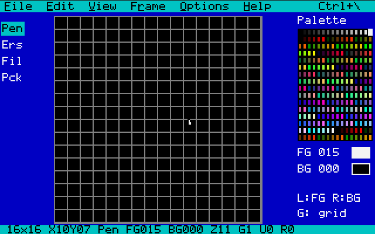
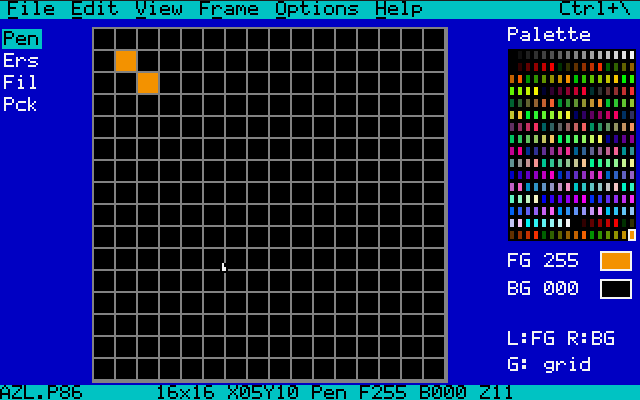
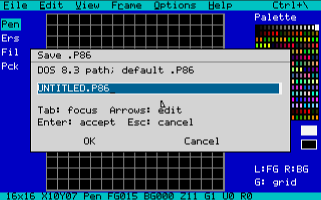
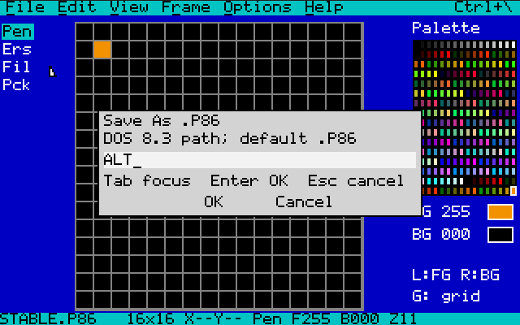
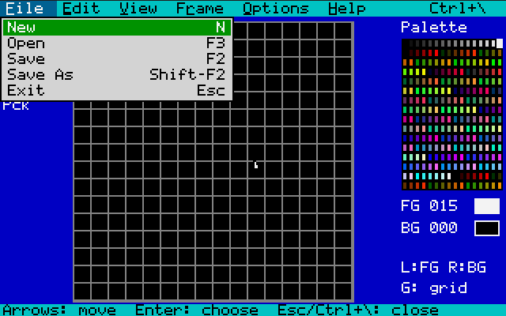
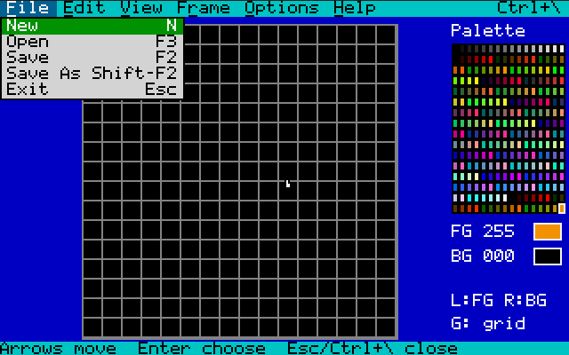
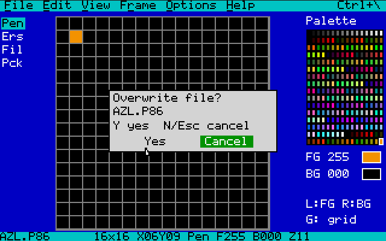

# TDE interface refactor

## Stage A: discovery and independent design (2026-11-14)

Branch `refactor/tde-interface` starts at main `0b29ab7`. Work already in
progress on the font/flicker fix is carried forward; no earlier change is lost.
This document records discovery before the additional architecture changes.

Inspected Pix86 video/font, cursor, rendering, keymap/keyboard, mouse, menu,
dialog/filename input, view, editor, project and file modules. Main already has
an original 6x8 font (95 glyphs, 760 bytes), contrary to the BIOS-font assumption
in the request. Keep that resource and improve layout, measurement and clipping.

Reviewed the local `~/Sync/git/tde/tde51vs` reference: `pull.c` for navigation
and restoration, `menu.c` and `menucua.c` for command grouping, `dialogs.c` for
compact prompts, `dos/console.c` for DOS input/display boundaries, `default.c`
for Ctrl+Backslash, and `config/tde.cfg` / `config/menu.cfg` for configuration
and visible menu conventions. Reference: https://github.com/raygibbon/tde.
The independent requirements are arrow navigation, explicit accept/cancel,
visible shortcuts, compact controls and restoration of covered content.
No reference code, structures, font data, artwork or pixel layouts are reused,
translated or adapted. Pix86 uses graphical indexed pixels and its own model
restoration rather than importing a text-mode console implementation.

Observed problems in the baseline:

- Layout lives partly in view.h and partly as literals in render/menu/dialog.
- Shortcut aliases are interpreted in editor, controller and menu descriptions.
- Main mixes input consumption, held-button suppression and command dispatch.
- A full workspace repaint follows every modal return, including cancellation.
- Menu opening/closing can clear the display; mouse motion repaints the bar.
- Unconditional cursor restore/save adds VGA traffic to otherwise idle polling.
- Boxes paint black over their whole interior before painting grey and text.
- Filename/status information and compact tools lack a shared layout contract.

The supplied Screencast_20261114_222249.mp4 shows repeated dark/paper sweeps
through the Unsaved dialog. It also shows an actual DOS text screen with Pix86's
cleanup message; that is an application exit, not a VGA repaint. The initiating
key cannot be determined from the recording. Test intercepted Escape explicitly.

## Stages and ownership

B: retain original font; share measurements, clipping and layout constants;
make tool rows compact without shrinking the drawing region.
C: one portable key-to-command mapping and input router; menu owns navigation,
controller owns file/help execution, editor owns drawing operations.
D: content-sized geometry; common label/field/button/choice painters; local
focus state; no paint when state does not change.
E: compare UI state; repaint changed rows/cells and exposed overlay rectangles;
restore from the model; protect cursor only on intersection. No shadow screen.
F: include bounded basename in status; keep canvas/history/file data untouched.
G: host/native regressions, VGA-write instrumentation, emulator recordings,
mode-restoration harness, screenshots and measured 16-bit link budget.

Changes are validated in this order. Existing font/flicker work has already
passed seven host suites, native EDTEST/IOTEST/UITEST/KBDTEST and a 3000-cycle
DOSBox-X interactive acceptance run. Additional stages require fresh checks.
The final validation record belongs in TESTING.md; build logs are local artifacts.

## Final architecture and stage checks

The implementation uses `layout.h` for shared screen/control bounds,
`command.h` / `keymap.c` for logical commands and shortcut aliases, `ui.c` for
menu-first dispatch and dismissal suppression, `uipaint.c` for borders/buttons,
`dlggeom.c` for compact geometry and `screen.c` / `region.c` for targeted damage.
Existing canvas/tools/history/project/file storage remain in place. There is
one UI path, no widget hierarchy, event queue or saved-screen subsystem.

Stages B–F built warning-free with Open Watcom and passed the relevant seven
strict C89 host suites; the final integrated paint/application test also passed
ASan/UBSan. Native EDTEST/IOTEST/UITEST/KBDTEST passed after integration. Full
visual acceptance and restoration evidence is recorded in TESTING.md.

The original 6x8 glyph resource was already on main; it remains unchanged.
The refactor reduces menu heading/row spacing and tool/dialog padding. It does
not scale glyphs or reduce the canvas. The filename/status addition uses a
bounded basename; the full path remains in the file dialog/project model.

