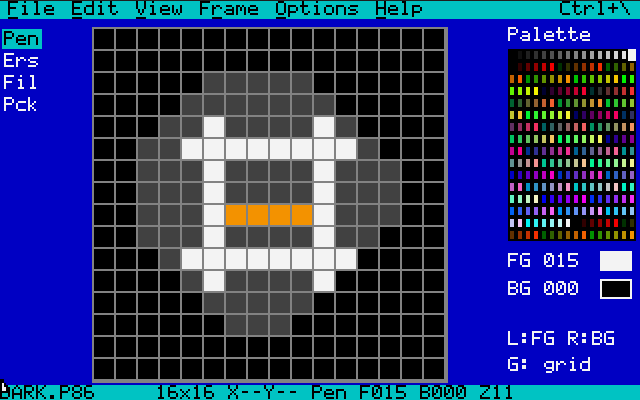
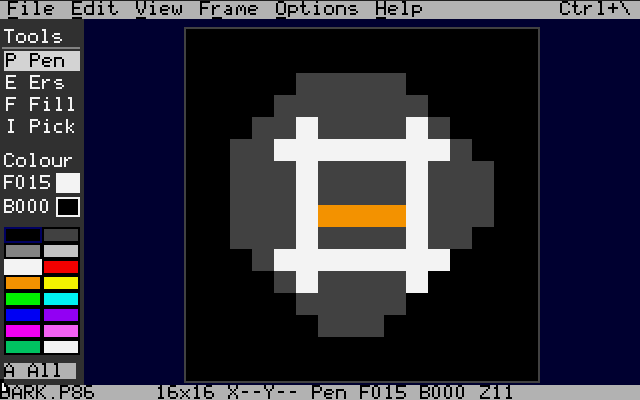
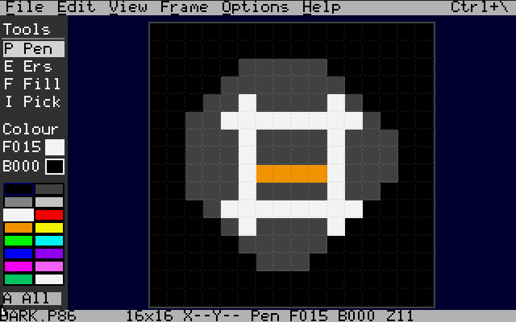
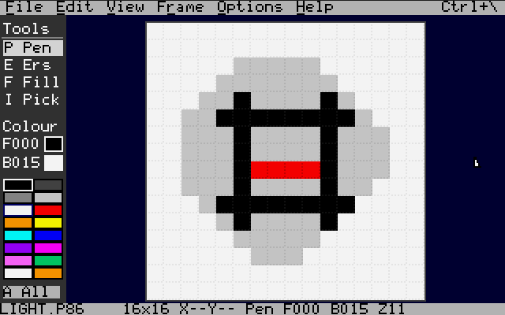
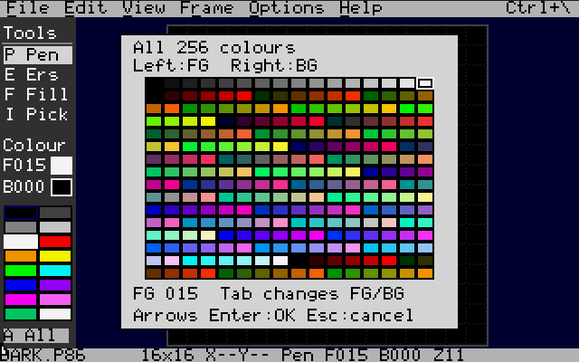
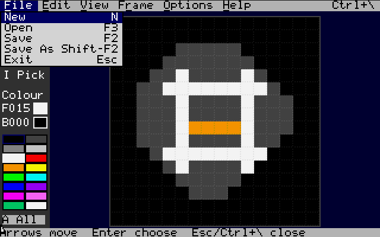
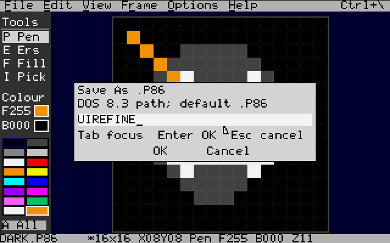
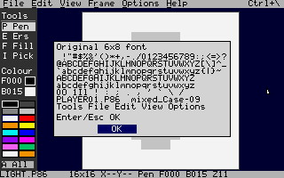
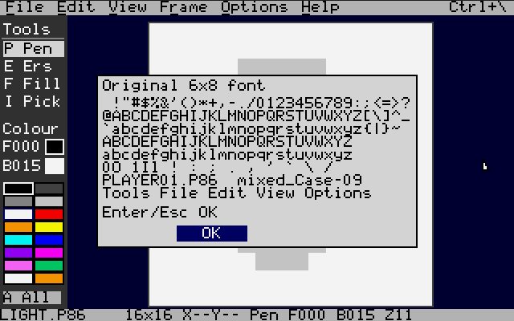

# Interface refinement: independent design

Branch: feature/tde-ui-refinement, based on main c038f08 (PR #5 merged).

Reviewed AGENTS.md and the existing font/layout/theme, view/editor integration,
menu/dialog painters, UI routing, screen invalidation and cursor protection.
The previous implementation already provides the required small-module
architecture. This pass changes presentation and palette access within it.

Reference review: local ~/Sync/git/tde/tde51vs/pull.c and dialogs.c for visible
navigation/highlighting/restoration concepts; config/tde.cfg and config/menu.cfg
for visual hierarchy and keyboard access. Existing Pix86 captures in docs and
the TDE menu/dialog visible in the supplied review screencast were used for
comparison. Separate copies of the two review screenshots were not available
in the attachments. No reference glyphs, source, data structures, graphics or
pixel layouts were copied, translated or adapted. Reference repository:
https://github.com/raygibbon/tde.

The specific adjustments are:

- Retain the original 6x8 cells and 760-byte glyph table. Open selected counters,
  remove doubled punctuation pixels and simplify heavy diagonals. Native
  lowercase/uppercase and filename ambiguity checks accompany a Font sample
  screen in Help, showing all 95 supported printable characters.
- Use quiet neutral menu/status/panel surfaces and one dark blue focus colour.
  The workspace remains distinct. All theme colours are existing indices;
  video.c and DAC programming are unchanged.
- Group four compact tool rows under Tools, with P/E/F/I in each row and a
  contrasting full-row active selection. Hit testing shares the same geometry.
- Move colour controls to the sidebar. Sixteen 19x8 working swatches have
  17x6 interiors, compared with the previous 2x4 interiors. Eight defaults stay
  fixed; the other eight remember recent colours. These are shortcuts to stored
  indices, never remapping rules. FG/BG have separate labelled swatches.
- A/B and the All control open the 256-index picker for FG/BG. All 256 cells
  remain reachable with keyboard or mouse. Left/right click chooses FG/BG;
  arrows move, Home/End select endpoints, Tab switches the target, Enter accepts,
  Escape/outside click cancels. [ and ] cycle working foreground colours.
- Remove the right palette panel. The drawing region grows from 222x176 to
  274x176 (about 23%), with the same maximum integer zooms 11/5/2. There is no
  canvas storage/file-format or timeline change.
- Start with grid off so artwork leads. G enables exact cell-edge dots, shaded
  relative to each displayed index. Dark artwork uses a near-dark grid rather
  than the previous middle-grey mesh. This is a view effect only.

The picker uses the existing synchronous dialog event loop and rectangle
restoration. Initial paint occurs once; navigation repaints two cells and one
value line; idle polling paints nothing. The working strip compares its cached
16 indices and affected FG/BG markers. No damage engine, allocation or framebuffer
is added. Canvas/tools/history/project/file code is retained; editor.c changes
only the initial grid preference, and view.c changes only palette hit translation.

Validation results, limits and measured memory values are recorded in TESTING.md.

## Captured comparison

The same original dark fixture was opened in main's executable and this branch.
The grid remains a view effect: enabled/disabled saves have identical artwork
bytes. At native resolution the white-art edge dot is grey 14 against white 15
(display RGB 227 versus 243); adjacent artwork pixels are unchanged.

The font was inspected at both resolutions, including lowercase, punctuation,
0/O and 1/I/l. The long diagnostic paints once; capture automation waits for
initial painting and native file writes to finish before comparing results.
No application delays were added to conceal repainting. The original polling
interval remains unchanged.
