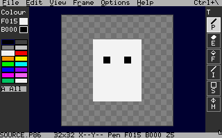
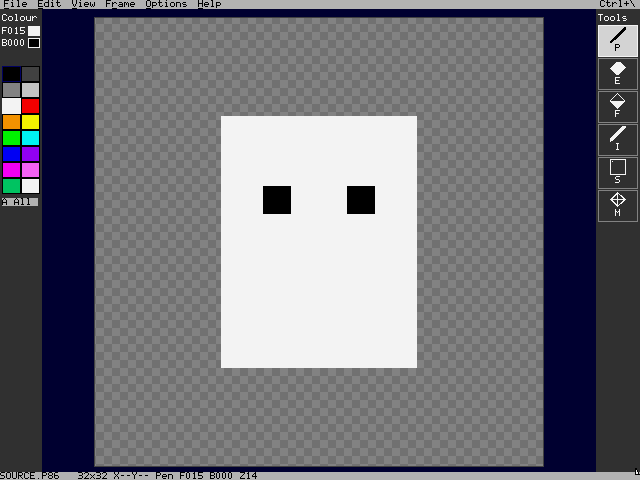
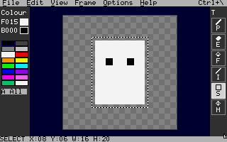
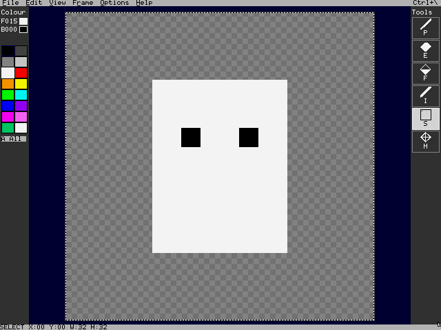
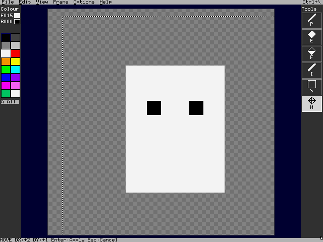
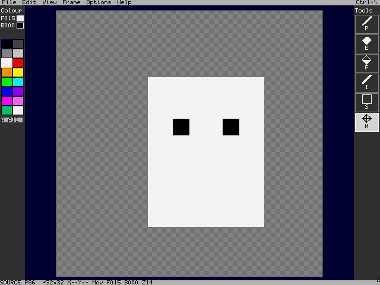

# Right toolbar and selection workflow

The selection controls remain current; see [COMPACT.md](COMPACT.md) for the latest
grouped toolbar, hidden menus and status-row animation layout. Screenshots below
record the earlier six-button layout.

## Use

Launch `PIX86` for classic 320×200 or `PIX86 /HIRES` for banked VBE 640×480.
Unavailable VBE falls back to classic; artwork dimensions and palette stay the
same. Six original right-hand icon buttons select Pencil P, Eraser E, Fill F,
Eyedropper I, rectangular Selection S and Move M. Palette, full 256-colour popup,
left/right FG/BG, preview and animation controls remain available. Classic marks
are 8×8; enhanced 16×16 marks are separately drawn. Text remains native 6×8.

1. Draw a sprite, then Ctrl+A for all artwork, or S and drag a rectangle.
2. Press M, or press inside the completed selection and drag. M without a
   selection lets you make a rectangle first.
3. Release to leave the move pending. Drag again from anywhere inside the
   floating rectangle; its pointer offset is retained. Arrows nudge one artwork
   pixel. Movement snaps at every integer zoom and clips safely beyond edges.
4. Enter applies the whole move as one edit. Escape cancels without changing
   indices, mask, history or saved state. Ctrl+D cancels/deselects too.
5. Ctrl+Z/U undoes the complete edit; Ctrl+Y/R redoes it. Selection-only actions
   and zero-displacement moves create no history entry.

Delete clears selected pixels with one undo action. With no selection it retains
frame deletion. Clearing uses document blank policy: transparent mask bits for
transparent blanks, or opaque current BG indices for opaque blanks. Other tools
and frame changes are blocked while floating; file operations (including File Exit) show an Apply/Cancel
reminder. Escape first cancels/deselects, then a later Escape uses the existing
Exit/unsaved-changes flow. Menus and dialogs own their keys before canvas editing.

Preview never writes artwork. A move captures source indices/masks once, clears
its source only in preview, then composites captured opaque pixels at destination.
Mask holes leave that cleared/original destination visible. There is no colour key:
index zero black is moved normally. Under transparent source clearing, hidden
source indices remain unchanged, matching Clear/alpha-eraser semantics. Applying
clips off-canvas content; Undo recovers it. A no-displacement move is exactly a
no-op even if the selected region contains mask holes. Selection and floating
state are not stored in `.P86` or exported. The v3 format remains unchanged and
legacy v1/v2 opacity is preserved.

## Native screenshots

All captures are native-size DOSBox-X images of an original fixture. They are
not stretched interface mockups. The workflow is checked at 5× canvas zoom in
classic and 14× in enhanced mode.

## Verification

- `scripts/test.sh`: all eleven strict C89 host suites pass.
- The same eleven suites pass with AddressSanitizer and UndefinedBehaviorSanitizer.
- `scripts/build.sh` and `scripts/dostest.sh`: Open Watcom small-model 8086 builds
  pass with warnings as errors.
- `scripts/rundost.sh`: EDTEST, IOTEST, UITEST, KBDTEST, ANIMTEST, BMPTEST,
  ALPHTEST, SELTEST, and VIDTEST classic/VBE all pass in DOSBox-X.
- `testsel.c` runs all six document shapes in both layouts: all tools, all four
  rectangle drag directions, clipping, every available zoom, offset-preserving
  repeated drags, arrows, real black, mask holes over existing artwork, clipped
  commits, cancel, no-op deduplication, bounded history and exact save/load.
- Rendering tests check borders and both toolbar layouts. Application routing
  tests exercise pending New/Open/Save, menu-owned arrows/Ctrl+A, commit and
  atomic undo/redo before saving. Existing idle writes, exact overlay restoration,
  Escape interception and file/export regressions remain passing.
- Native GUI checks in both actual video modes select a 32×32 sprite, drag by
  (+3,+2), nudge by (-1,-1), commit, undo, redo, save and reopen. Independent
  Python comparisons verify all v3 index and mask bytes; Undo reproduces the
  original file byte-for-byte. VBE tests verify palette indices, the 64 KiB bank
  boundary, clipping, bottom-right pixel and return to the original text mode.

The DOS runner uses a generated 8.3 batch file so its growing suite does not hit
DOSBox-X's command-line command limit. Its disposable directory is removed only
after every PASS is recorded. A separate `vgaonly` run also confirms `/HIRES` fallback and text restoration.
The test configuration uses `svga_s3`, 40,000
cycles and full-precision INT 33h coordinates. Native mouse automation must allow
the polling loop time to see presses before moving the pointer. Starting a float
and releasing a stationary drag avoid unnecessary full selection repaints.

## Memory, scope and provenance

Final DOS executable: 66,980 bytes. `_TEXT`: 60,728 bytes. DGROUP: 43,312 bytes,
including the 4096-byte stack, leaving 22,224 bytes below 64 KiB. Seven existing
far document snapshots still reserve 129,318 bytes. Selection state adds 26 DOS
bytes to Editor; capture reuses 4608 bytes of the existing 8192-byte fill workspace.
No allocation occurs during dragging and no screen/sprite-sheet buffer is added.

The first-party driver integration comes from the repository's unmerged
`feature/dual-display-modes` branch at `70d79e5`. It keeps the latest main's
animation, masks and exports instead of replacing them with that older branch's
editor. Existing MIT licensing applies; no external dependency is added.

[Aseprite selecting](https://www.aseprite.org/docs/selecting/) and
[moving](https://www.aseprite.org/docs/move-selection/) supplied functional ideas
only. Pix86 uses original icons, rendering and state transitions, explicit
Enter/Escape and its own S/M shortcuts. TDE's previously documented theme review
remains reference-only. No reference code or assets were copied. The DOSBox-X
[mouse guide](https://dosbox-x.com/wiki/Guide:Mouse-support-in-DOSBox%E2%80%90X)
documents the full-precision test setting.

Rotation, scaling, copy/paste, multiple selection regions and animated marching
ants are outside this change. Physical DOS/SVGA cards and external mouse drivers
remain unverified; keyboard nudging always uses exact artwork pixels. Enhanced
mode needs a compatible banked VBE 1.2 mode 101h; there is no linear framebuffer,
protected mode or extender requirement.
