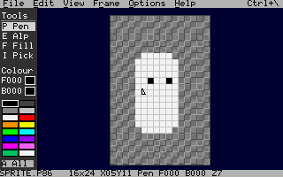
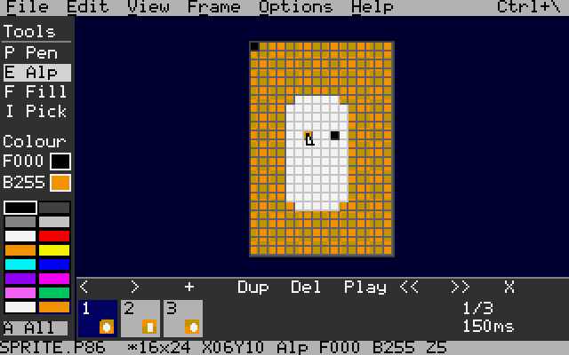

# Background, transparency and export

Preserve Mode 13h, 8086 small-model DOS, the existing Canvas/tools/history,
frame limits, file transactions, modal routing and dirty-region rendering.

1. Neutral continuous pixel grid, with independently toggled 8/16 guides.
2. Separate BG erase/fill selection, view-only preview colour and artwork.
3. Packed mask: 1 means transparent, independent of the indexed byte. Reserve
   2048 bytes per Animation and 512 active-frame bytes. Seven snapshots still
   fit below 32 KiB each; DGROUP remains below 64 KiB, no new allocations.
   Pencil/fill make pixels opaque; transparent eraser preserves hidden indices.
   Blank-frame policy is explicit document metadata; switching it leaves existing
   pixels unchanged. Preview checkerboard/colour/link and eraser mode are UI state.
4. P86 v3 retains the 24-byte header. Byte 22 is default transparent-blank policy,
   byte 23 zero. Each frame has duration, index bytes, then packed mask. Old v1/v2
   load opaque. Mask/default policy participate in history and exact dirty state.
5. BMP requires an explicit flatten choice for masked pixels. PNG RGBA uses the
   same RGB conversion and per-pixel alpha, preserving black independently.
6. Original streaming PNG uses filter 0 and stored DEFLATE blocks, small IDAT
   chunks, computed CRC32 and Adler32, without a zlib dependency or large buffers.
7. Extend the existing export modal and document options, then host/native tests,
   independent PNG/BMP readers, low-flicker regressions, memory and screenshots.

No third-party source, assets or libraries are imported. PNG/zlib/DEFLATE field
contracts come from W3C PNG and RFC 1950/1951; implement independently.

## Behaviour and verification (2026-11-15)

New sprites default to Transparent; the New dialog also offers Opaque and fills
with the currently selected BG index. Changing preview colour, checker or link
never writes indices or masks. Old v1/v2 files load fully opaque, including zero.
BG fill requires confirmation; undo restores both indices and masks. Four undoable
operations include mask edits, frame changes and default blank policy. Native v3
persists hidden indices, masks and policy without storing preview UI state.

All ten host suites pass with strict C89 warnings, as do all ten ASan/UBSan suites.
`scripts/build.sh` and `scripts/dostest.sh` compile with Open Watcom, warnings as
errors. `scripts/rundost.sh` executes EDTEST, IOTEST, UITEST, KBDTEST, ANIMTEST,
BMPTEST and ALPHTEST successfully in DOSBox-X. Disposable I/O directories isolate
fixture and failure tests. Regression coverage includes opaque black, same-index
paint over transparency, both erasers, fill/undo, frame masks/history, all v3
truncated prefixes and strict headers, v1/v2 opacity, export overwrite/cancel and
partial failures, PNG disk-full injection, independent PNG CRC/zlib/Adler/RGBA
checks, and the existing idle-write/exact-overlay/cursor/Escape checks.

`python3 tests/pngcheck.py build/alphatest-files` additionally validates every RGBA
byte with independent Pillow and zlib. It checks current, numbered, horizontal,
vertical, grid, flatten and a 75,443-byte 256x64 output spanning 64 KiB. BMPTEST
checks odd-width padding, all palette entries, exact indices, dimensions, frame
order, 8.3 names, transactions and large output; a native graphical run additionally
opens exported BMP/PNG with Pillow. The original DOS BMPVIEW diagnostic remains
available for BMP display. PNG decoding in an external DOS image viewer and real
FreeDOS/MS-DOS hardware are not verified; ALPHTEST independently decodes PNG under
DOSBox-X. Stored DEFLATE favours small bounded memory over compressed file size.

The native New-dialog run also verifies Transparent defaults, Opaque fills BG 255,
exact saved mask/policy bytes, and preview changes leave the native file unchanged.

The native visual run draws opaque index zero, erases an existing black eye to
alpha, changes BG/preview, cancels and undoes a confirmed BG fill, saves/reopens
v3, and exports every layout/mode. Independent Pillow comparisons match all pixels;
saved native bytes remain unchanged by preview and export. Native screenshots
below use an original 16x24 three-frame black/white fixture, no reference assets.

[Native transparency workspace](TRANS.PNG) · [PNG export dialog](PNGDLG.PNG) ·
[New document choices](NEWDOC.PNG)

Final DOS build: executable 60,202 bytes; near code 54,536 bytes; DGROUP 41,856
bytes including the 4096-byte stack, leaving 23,680 bytes below 64 KiB. Each of
seven far snapshots is 18,474 bytes, totalling 129,318 bytes. Active masks add
512 near bytes, each snapshot reserves 2048 mask bytes, and the near file scratch
has the same complete document size. No sheet-sized allocation or additional
far allocation is introduced. Initialization failure frees partial allocations;
the existing host allocation-failure suite remains passing.

The encoder and mask implementation are original ANSI C. Factual format sources
are [Microsoft BMP](https://learn.microsoft.com/en-us/windows/win32/gdi/bitmap-storage),
[W3C PNG](https://www.w3.org/TR/png-3/), and RFCs
[1950](https://www.rfc-editor.org/rfc/rfc1950.html)/[1951](https://www.rfc-editor.org/rfc/rfc1951.html).
No third-party code, fonts, artwork, palettes or dependencies were imported.
