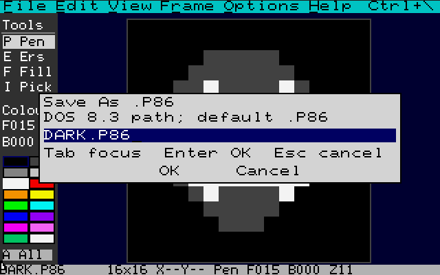

# Pix86 compact DOS interface

Pix86 defaults to VGA Mode 13h (320x200, 256 colours) with a single-image
document. Enhanced VBE 640x480x256 is selectable with `/640`; `/320` selects
Classic explicitly and `/HIRES` remains an alias. Canvas pixels, history, file
format and save replacement guarantees are unchanged. Animation remains planned.

## Reference review and original implementation

Reviewed the local TDE 5.1v distribution at
`/home/rgibbon/Downloads/tde51vs/` on 2026-11-14. The earlier review used
`readme_s.txt`, limited menu/prompt behaviour review, and `update.txt`. This
redesign additionally reviewed `config/tde.cfg`, `config/menu.cfg` and the help
screen in `config/tde.hlp`: compact character-cell menus, dense typography,
light menu/dialog surfaces against a dark work area, contrasting selected rows,
muted unavailable commands, thin framing, visible shortcuts, and a separate
single-line status area. The supplied distribution contains no reference
screenshots or complete runnable TDE executable; its tdv.exe is a loader stub.

These are visual/functional observations, not implementation templates. Pix86's
coordinates, font, colours, module interfaces and bitmap rows were designed
independently. No TDE code, structures, strings, layouts, fonts or binary glyphs
were copied, translated or adapted. Its public-domain description did not
supply permission for imports. Reference URL:
<http://adoxa.altervista.org/tde/dl.php?f=source>.
LibreSprite remains a workflow aspiration. GrafX2 and Animator/Animator Pro
source/assets were not consulted or imported.

## Typography and colour

Menus and dialogs now use the original 4x6 face in fontui.c. Editor labels and
status keep the original 6x8 face described below. Both share one renderer, with
explicit role metrics, opaque fills and control-local clipping. The native
comparison and TDE behaviour review are in [FONTMENU.md](FONTMENU.md).

`font.c` contains 95 original hand-drawn printable ASCII glyphs, each eight
rows of five ink bits: 760 bytes of bitmap data. Every cell advances six pixels,
leaving a blank spacing column. Lowercase has distinct shapes and descenders;
there is no antialiasing, scaling, ROM-font lookup or conversion from another
font. Unsupported bytes use the original question-mark glyph. The renderer
clips transparent ink at all four edges using long coordinate intermediates;
transparent text never changes pixels outside the screen or a glyph's ink.
Opaque text writes final ink/paper per cell, avoiding a background wipe followed
by text. Control-local clipping bounds filename/title text. `font.h`
defines the shared editor and menu/dialog metrics. Rendering tests exercise the actual bitmap path.

`theme.h` names UI indices from the existing fixed palette: deep blue work area,
cyan menu bar, neutral status line, grouped dark sidebar, light grey
dropdowns/dialogs, dark ink, bright green selection and
muted disabled text. The theme deliberately does not reprogram DAC entries: all
256 artwork indices retain their RGB values and existing `.P86` files render
identically. These original choices reflect conventional DOS colour
relationships, without reproducing a reference palette or screen.

## Workspace

The menu occupies y=0..8. The drawing region is x=44..317, y=14..189:
274x176 pixels (about 23% larger than the previous 222x176). The 42-pixel left
strip groups Tools, Colour, current FG/BG, sixteen working swatches and All.
Four 38x10 rows carry P/E/F/I shortcut labels and a full-row selection highlight.
Render and hit testing share layout.h. No right-hand panel remains.

Working swatches use 19x8 cells with 17x6 interiors. Eight stable defaults and
eight recent indices provide quick access; left/right selects FG/BG. A/B and
All open the full 16x16 popup, whose 10x7 cells expose all indices 0..255.
Arrows wrap, Home/End select 0/255, Tab changes FG/BG, Enter accepts, and Escape
or an outside click cancels. Mouse left/right immediately chooses FG/BG. [ and ]
cycle working foreground colours. File Open and eyedropper selections also
enter the recent strip, without changing any pixel index or saved file format.

Canvas sizes and maximum integer zooms remain 16/32/64 and 11/5/2. Grid starts
off, and G toggles shaded dots at exact displayed cell edges at zoom >=2.
Black/white pixels use adjacent grey indices; colour-cube pixels use a nearby
shade. Dots reduce coverage compared with solid mesh lines. Rendering never
changes artwork. A future timeline can reserve view space without storage changes.

The single eight-pixel status line at y=192 shows the bounded DOS basename, modified marker, dimensions,
X/Y, tool, FG/BG indices and zoom. Without a mouse it retains document information
and uses X--Y--. Menus temporarily replace it
with navigation guidance. View changes do not mark the project modified.

## Menus and keyboard

The single menu row reads File, Edit, View, Frame, Options, Help, with a compact
`Ctrl+\` reminder at right. Ctrl+\ opens File from the editor and closes any
open menu on the next press. F10 reopens the last heading and Alt+F/E/V/R/O/H opens a specific heading. The R
in Frame avoids colliding with File; headings underline their mnemonic.
Left/Right wraps headings, restoring the last row in each. Up/Down wraps command
rows and skips separators. Enter executes and Escape closes. Letter prefixes
execute enabled commands immediately; unavailable prefixes do nothing. Row
selection survives cancellation, command execution and reopening.
Drawing shortcuts are consumed while a menu is open and retain their bindings
when closed. Frame operations remain disabled placeholders.

Dropdowns use a one-pixel border, nine-pixel command rows and three-pixel
separator rules, left-aligned command names
and right-aligned shortcut labels. Disabled commands stay visible in muted ink
and cannot execute. Fresh mouse presses activate headings/items. An outside
left click closes the menu and is consumed; release before drawing again.
Dropdowns disappear before commands open dialogs. Opening a menu paints its bounds and changed headings/status; moving the
selection paints the old/new rows only. Switching headings or closing restores
only exposed rectangles from the editor model. No screen-sized backing buffer or
widget framework is used.

`keyboard.c` polls BIOS INT 16h through Watcom's `_bios_keybrd`, retaining AH's
scan code and AL's character. `keymap.c` interprets this word separately from
DOS acquisition. Ctrl+\ conventionally produces character 1Ch (FS); recognizing
that queued word works even after Ctrl is released. When a BIOS/layout returns
zero, backslash or pipe instead, the decoder also recognizes Ctrl plus US scan
2Bh, or Ctrl plus a logical backslash on another scan code. Plain backslash
and Ctrl+Alt/AltGr backslash remain filename characters. Extended keys preserve
the existing `256 + BIOS scan` representation. No interrupt handler is installed.

A BIOS word does not carry per-event modifier flags. The fallback uses the
current BIOS Ctrl/Alt flags and is best-effort when a nonstandard driver omits
FS and Ctrl has already been released. Layouts remapping both scan and control
character may require F10/Alt+F. The application does not claim universal layout
support. Standard XT-compatible BIOS keyboard services are used; additional
keys outside Pix86's documented bindings are not promised.

Factual contracts: [RBIL INT 16h get keystroke](https://delorie.com/djgpp/doc/rbinter/id/63/17.html)
(AH scan, AL character and legacy extended-key limitations), local Watcom
`h/bios.h`, and [DOSBox-X regional settings](https://dosbox-x.com/wiki/Guide:Regional-settings-in-DOSBox%E2%80%90X)
(layout selection with `KEYB`, including UK). These are specifications, not
source-code dependencies. Actual tested layouts/results are in TESTING.md.

## Dialogs and input ownership

Content-sized centred windows (a filename prompt is 136x58; a short confirmation
is 96–104x50) have thin dark borders, a compact title and 4x6 text.
Controls are flat text choices, 32x8 pixels, with a contrasting selected row.
Filename fields show 32 characters, scroll to the insertion cursor, and are
highlighted when focused. Typing replaces the selected prefill; cursor movement
ends selection. Left/Right/Home/End, Backspace/Delete, Tab/Shift+Tab, Enter and
Escape retain their behaviours. Click inside the field to place the cursor.
Open, Save and Save As share this path; validation remains in the file adapter.

New offers 16/32/64 sizes using arrows, number keys or mouse. Confirmation
prompts initially select Cancel; Y/Yes approves, N/Escape/Cancel abandons the
operation. Enter activates the highlighted control. Error messages retain room
for both recovery paths, with 38 characters per wrapped line. No file browser
is introduced.

Overlay painting protects the cursor only when their regions overlap. Dialog polling consumes fresh
presses, including between consecutive prompts; dismissal blocks held buttons
until release before returning to the editor. Cancelled or failed Open retains
pixels, dimensions, filename, history and saved baseline. File-format handling
remains independent from UI code.

## Refactor review

The additional source review, responsibility boundaries, supplied screencast
analysis and before/after measurements are recorded in [REFACTOR.md](REFACTOR.md).
The original font predates this refactor; a later refinement updates selected
glyphs while retaining its format and metrics. Layout,
opaque text and dirty painting make the interface denser and steadier without
scaling or importing any reference glyphs.

## Font and working-palette refinement

Eighteen original glyphs were redrawn to open counters, simplify heavy diagonals
and use single-pixel punctuation. The cell advance, baseline and 760-byte font
size remain unchanged. The original zero is narrower than O; lowercase remains
distinct. `PIX86 /FONT` compares all 95 printable characters in both original faces,
including filename ambiguities. [REFINE.md](REFINE.md) records the reference comparison and captures.

The all-colour popup shares existing modal polling, input ownership and covered
rectangle restoration. It paints once, then repaints only changed cells/value
text. Both pointer buttons and dismissal are consumed before drawing resumes.
The working palette is UI state, not a new artwork palette or remapping table.

## Dual display modes

Classic retains 320x200 Mode 13h and the original 6x8 editor/status font with
the compact 4x6 menu/dialog face. Enhanced requests VBE mode 101h
(640x480x256), validates the reported mode and uses an independently drawn
8x16 face. The 307,200-byte image is accessed through VBE's banked window; it
is never treated as a linear pointer. VBE operations are isolated from the
common video interface and VGA backend. Unsupported VBE falls back to Classic
with a diagnostic. Neither mode allocates a screen-sized buffer or uses a DOS
extender.

The artwork canvas remains 16x16, 32x32 or 64x64 in software memory. The
Enhanced layout supplies a 552x440 drawing region and retains the same indexed
palette, integer zoom, tools, project files and history. Menus retain
nonselectable separators, alphabetic accelerators, remembered rows and
right-aligned shortcuts. Enhanced uses a cyan bar, grey dropdowns, green
selected rows, muted disabled items and 17-pixel menu rows. Ctrl+backslash,
arrows, Enter, Escape, mouse routing and release-after-dismissal behavior are
shared with Classic. Display mode changes require restarting Pix86.

The paired captures in [VIDEO_MODES.md](VIDEO_MODES.md) compare the same blank
32x32 editor state in both modes. Mode 13h is displayed at integer 2x scaling
and VBE at native 1x DOSBox-X scaling. TDE's compact menus, dense typography,
muted unavailable items and separate status area informed the functional
requirements; Pix86's code, glyphs, geometry, colours and screen remain
independently authored. `PIX86 /FONT` displays all printable ASCII in the
active mode: Classic shows the editor and compact UI faces, while Enhanced
shows its 8x16 face.
