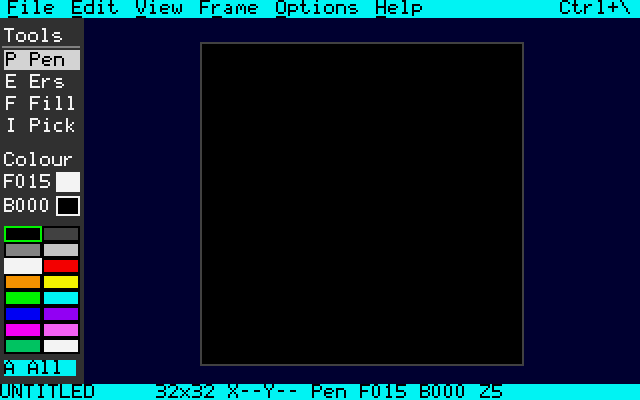
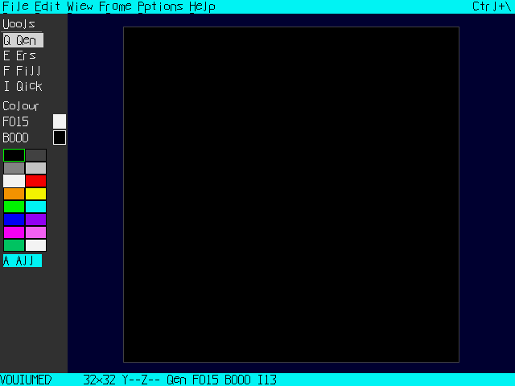
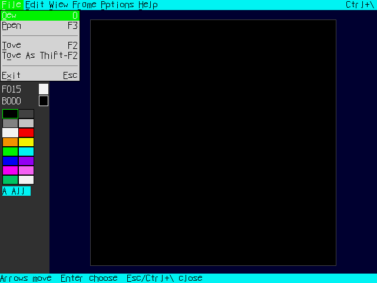
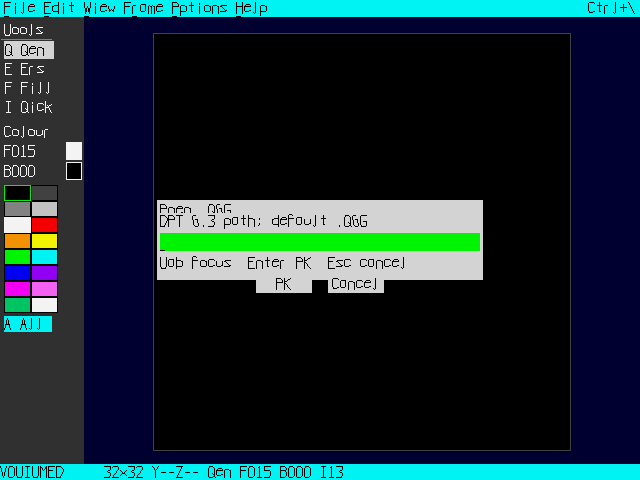

# Experimental video modes

The `experiment/high-resolution-vga` branch adds an opt-in `/HIRES` display
experiment. Plain `PIX86` remains Mode 13h (320x200, 256 indexed colours).
The editor canvas and `.P86` pixels remain software data, independent of either
screen size. The experiment is not the default and does not change the file
format or the artwork palette indices.

## Options considered

| Option | DOS/VGA compatibility | Memory and palette | Performance and complexity |
| --- | --- | --- | --- |
| VGA Mode 12h, 640x480x16 | Standard VGA BIOS mode; works on real-mode DOS, DOSBox-X and 8086/286-class CPUs | Four VGA planes; only 16 simultaneous indices | Broad compatibility, but loses 240 palette indices and needs planar pixel/rectangle operations. Not suitable for the unchanged 8-bit artwork. |
| 640x400x16 custom VGA | Possible on VGA hardware, but not a standard BIOS mode | Planar 4-bit pixels and 16 colours | Requires custom CRTC programming and a distinct renderer. Not selected. |
| Unchained VGA / Mode X, 320x400 or 360x400 | VGA hardware, including DOSBox-X; real-mode 8086 code can program VGA registers | Four 64 KiB planes; 256 DAC indices. Each plane stores every fourth pixel; the memory is not a linear packed-pixel framebuffer. | More vertical room and all indices, but only 320/360 horizontal pixels. Requires plane selection, address mapping, register-state restoration and specialized fill/text code. Not selected. |
| VBE 640x480x256, mode 101h | Requires a VBE 1.2-or-newer BIOS that advertises the mode and a writable window. DOSBox-X provides it; ordinary VGA BIOSes need not. The application remains 16-bit real-mode/8086 code. | Packed 8-bit pixels through a banked window. The 307,200-byte image exceeds a 64 KiB window; bank selection is mandatory. All 256 indices remain available. | Best typography and workspace while preserving indexed artwork. BIOS bank changes and per-pixel rendering make full redraws slower. Isolated in `video.c`. Selected for the experiment. |
| Improved font in Mode 13h | Existing VGA BIOS support and current DOSBox-X/hardware reach | 320x200 and all 256 indices remain unchanged | Least risk and cost. The 6x8 cell still limits interface density and workspace; this remains the default. |

640x400x256 is not assumed to be a standard VGA BIOS mode. A VBE implementation
may advertise other modes, but Pix86 currently requests only 101h and validates
the returned mode information before switching. If the VBE controller, mode,
packed-pixel model or writable window is unsupported, startup uses Mode 13h and
displays a diagnostic. A bank-switch failure during use ends the session,
restores the original text mode/page/cursor, and reports the failure.

## VBE backend

The backend verifies VBE 1.2+, mode 101h support, 640x480 dimensions, 8 bits per
pixel, packed-pixel memory model, scanline stride, window segment, size and
granularity. It selects Mode 101h using BIOS INT 10h, then accesses Window A
through the segment and current 64 KiB bank. Pixel offsets use the reported
stride; rectangle fills split at the current window boundary. No linear 256 KiB
or 307,200-byte conventional-memory framebuffer is allocated or assumed.

Mode initialization, DAC palette setup, dimensions, pixel reads/writes, clipped
rectangle fills, bank errors and prior video-mode/page/cursor restoration stay
inside `video.c`. The editor still owns its bounded 16x16, 32x32 or 64x64
canvas and integer zoom; mouse coordinates use the active screen geometry.
VBE uses the existing 256-entry indexed palette, without remapping artwork
pixels. UI accents use palette indices 226 (cyan) and 46 (green); no theme change
rewrites the DAC.

The normal-mode UI retains the original 6x8 bitmap font. `/HIRES` selects an
independently authored 8x16 stroke font, rasterized into monochrome glyph
bitmaps; it is not an enlarged 6x8 font or a ROM/reference font. Its 8-pixel
advance yields 80 columns and 30 rows at 640x480. The 6-pixel advance at 320px
provides 53 complete columns; both modes keep the existing single status row.
The experimental font has distinct lowercase, digits and punctuation. The
Help > Font sample screen renders printable ASCII.

The high-resolution layout uses the added space for an 84-pixel tool/colour
sidebar, a centered integer-zoom canvas, palette swatches and one status line.
The menu is cyan, dropdowns are grey, selected rows green, shortcuts right
aligned, and separators/non-executable rows are drawn without changing the
underlying Pix86 commands. Ctrl+backslash, arrows, Enter, Escape, mouse input
and per-heading row memory remain supported. These are original Pix86 controls;
TDE is cited as a functional DOS-interface reference in [UI_DESIGN.md](UI_DESIGN.md).

## Captures

The following captures show the same startup state: an unmodified 32x32 canvas,
default tool and foreground/background selections. Mode 13h is displayed at
integer 2x scale (640x400); VBE 101h is displayed at 1x (640x480). These are
DOSBox-X window captures, not rescaled font samples.

| Default: Mode 13h | Experimental: VBE 101h |
| --- | --- |
|  |  |

The dropdown and filename dialog use the same hires font and active-screen
bounds:

At 640x480, the 8x16 text has TDE-like DOS proportions and the dropdown shows
the cyan/grey/green treatment, separators and right-aligned shortcuts. The
workspace and sidebar gain substantial room. The canvas remains a 32x32 image;
only its integer display zoom changes. No TDE screenshot, bitmap, code or
distinctive artwork is included.

## DOSBox-X measurements

`tests/bench.c` measures the real renderer and modal/menu code under DOSBox-X
2025.02.01, normal 386 core, fixed 3000 cycles/ms. Each number is the BIOS
18.2 Hz timer total for repeated operations, with an approximate per-operation
value; timer resolution is about 55 ms, so small values are coarse. The same
32x32 blank document and compiled application modules are used in each mode.
Bench runs are not hardware-throughput guarantees.

| Operation | Runs | Mode 13h total / approx. per run | VBE 101h total / approx. per run |
| --- | ---: | ---: | ---: |
| Initial screen render | 5 | 102 ticks / 1,122 ms | 501 ticks / 5,511 ms |
| Menu open and close | 20 | 58 ticks / 159 ms | 296 ticks / 814 ms |
| Menu navigation | 100 | 4 ticks / 2 ms | 5 ticks / 2 ms |
| Dialog open and restore | 10 | 48 ticks / 264 ms | 149 ticks / 819 ms |
| Canvas zoom redraw | 20 | 142 ticks / 390 ms | 689 ticks / 1,894 ms |
| Continuous drawing | 10 strokes | 2 ticks / 11 ms | 2 ticks / 11 ms |
| Full palette popup | 10 | 185 ticks / 1,017 ms | 607 ticks / 3,338 ms |

The larger screen materially increases full-screen, zoom and popup work: in this
run the high-resolution initial render took about 4.9x as long, zoom about
4.9x, and the full palette popup about 3.3x. Menu and status text are fully
painted in this measurement; the additional banked text writes make menu
open/close slower than Mode 13h. The continuous-drawing and navigation figures
are near the timer's resolution and should not be read as precise latency.
Avoiding unnecessary redraws remains important; no full-screen shadow buffer or
double buffer was added.

## Verification and recommendation

Open Watcom builds the application for 16-bit real mode (`-bt=dos -ms -0`).
The DOSBox-X video harness passed both Mode 13h and VBE 101h tests, including
pixel read/write, all palette indices, clipping, the 64 KiB bank boundary,
rectangle fills across that boundary and restoration to the prior BIOS mode.
Host tests, the application build and DOS test builds pass. DOSBox-X KBDTEST,
VIDTEST in both modes, IOTEST and UITEST passed; UITEST uses an 8 KiB test-only
stack, while the application's 4 KiB stack is unchanged. EDTEST was not run at
the user's request. The VBE mode, menu and filename dialog were visually
captured in DOSBox-X. Native VBE BIOSes, physical VGA/VBE hardware and
unsupported-VBE startup fallback were not available for this run.

**Recommendation:** retain Mode 13h as the default. `/HIRES` is useful on
DOSBox-X or a machine with a compatible VBE 1.2+ BIOS when text density and
editing space matter more than redraw speed. The 8x16 display is meaningfully
clearer, but the measured render/zoom/palette costs and firmware dependency do
not justify replacing the broadly supported 320x200 path.
